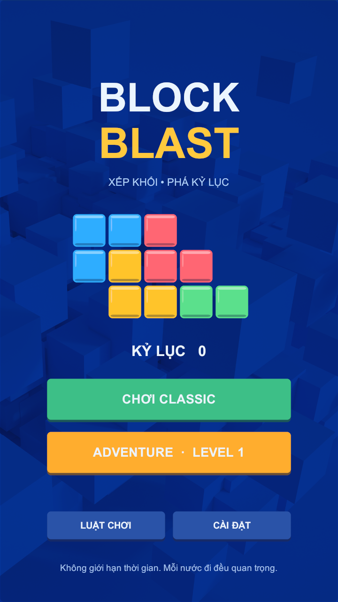

# Block Blast Unity

Game xếp khối trên bảng 8×8, viết bằng Unity **2022.3.62f3**.

## Chơi ngay trên Windows

[Tải BlockBlast-Windows.zip](https://github.com/pthao2211/block-blast-unity/releases/latest), giải nén toàn bộ rồi chạy `BlockBlast.exe`. Giữ nguyên thư mục `BlockBlast_Data` và `MonoBleedingEdge` cạnh file EXE.

## Mở mã nguồn

1. Clone hoặc tải repo và giải nén.
2. Unity Hub → Add project from disk → chọn thư mục repo.
3. Mở bằng Unity 2022.3.62f3, đợi Unity tải package và import asset.
4. Mở `Assets/Scenes/SampleScene.unity`, nhấn Play.

## Cơ chế và luật chơi

- Kéo một trong ba khối vào các ô trống. Không xoay khối; dùng hết ba khối để nhận bộ mới.
- Lấp đầy hàng hoặc cột để xóa chúng cùng lúc; tạo combo để tăng điểm.
- Classic: chơi đến khi không còn chỗ đặt khối; lưu ván đang chơi và điểm cao nhất.
- Adventure: hoàn thành mục tiêu điểm trong 30 lượt; mở khóa cấp tiếp theo.
- Mỗi ván có một lần dùng búa xóa ô, bom xóa vùng 3×3 và đổi bộ khối.
- Có tạm dừng, chơi lại, hướng dẫn, âm thanh và cài đặt rung trên thiết bị hỗ trợ.

## Cấu trúc

- `Assets/BlockBlast/Scripts/BlastModel.cs`: bảng, hình khối, tính điểm, xóa hàng/cột và trạng thái ván.
- `Assets/BlockBlast/Scripts/BlastGame.cs`: giao diện, kéo thả, âm thanh, lưu tiến trình và các màn hình.
- `Assets/BlockBlast/Editor/BlastEditor.cs`: kiểm tra luật chơi trong Unity Editor.
- Mục Releases: bản Windows đã build và chạy kiểm tra.

## Kiểm chứng

Đã chạy 23 nhóm kiểm tra luật, 892 lượt đặt khối hợp lệ với 29 hình khối; kiểm tra kéo thả, lưu/tiếp tục, tạm dừng, thắng Adventure và cứu ván bằng bom. Bản Windows đã chạy smoke test thành công. Chạy EXE với `--blast-smoke-test` để kiểm tra tự động và thoát.

## Thiết kế và tài nguyên

Nền `FigmaBackground.png` lấy từ [file Figma do chủ project cung cấp](https://www.figma.com/design/Yz3Ecvsd9XhcsYpk6F2Cfh/?node-id=0-1), node `132:1936` (Asset 23-8). Các khối, nút và hiệu ứng còn lại được dựng bằng Unity. Đây là bản game chơi được, chưa tái hiện đầy đủ toàn bộ thiết kế Figma do giới hạn lượt truy cập MCP khi lấy asset.

Repo chưa cấp giấy phép sử dụng lại mã nguồn hoặc tài nguyên. Quyền đối với tài nguyên Figma thuộc chủ sở hữu tương ứng.

